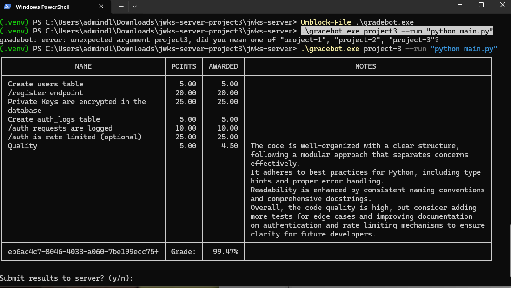
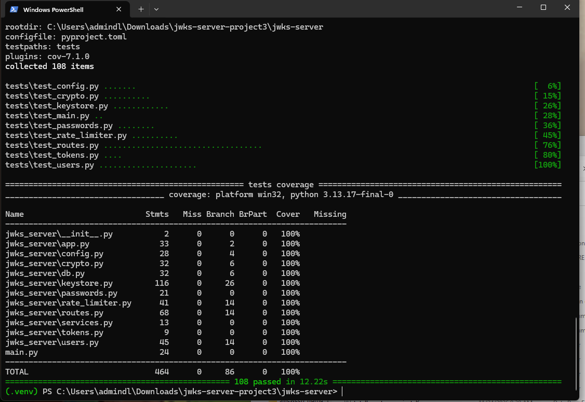

# JWKS Server: Project 3

A JWKS server in Python (Flask) that issues RS256 JWTs and publishes its public keys. Project 3 adds:

- **AES-encrypted private keys.** Keys are encrypted at rest with AES-256-GCM, using a key derived from the `NOT_MY_KEY` environment variable.
- **User registration.** `POST /register` creates a user with a UUIDv4 password, hashed with Argon2id.
- **Auth logging.** Every successful `POST /auth` is recorded in `auth_logs`.
- **Rate limiting.** `POST /auth` allows 10 requests per second per client and returns `429 Too Many Requests` after that.

## Gradebot results



## Test coverage



## Setup

Requires Python 3.10 or newer.

**Windows (PowerShell)**

```powershell
python -m venv .venv
.\.venv\Scripts\Activate.ps1
pip install -r requirements-dev.txt
```

**macOS / Linux**

```bash
python3 -m venv .venv
source .venv/bin/activate
pip install -r requirements-dev.txt
```

### Set the encryption key

The server will not start without `NOT_MY_KEY`. Generate a random value once, save it somewhere private like a password manager, and set it in the same terminal you run the server from. **Never commit it.**

```powershell
# Windows (PowerShell)
python -c "import secrets; print(secrets.token_hex(32))"
$env:NOT_MY_KEY = "<paste the value here>"
```

```bash
# macOS / Linux
python3 -c "import secrets; print(secrets.token_hex(32))"
export NOT_MY_KEY="<paste the value here>"
```

Use the same value every time. If it changes, keys encrypted with the old value can't be decrypted. The server skips those keys and generates new ones, so it keeps working, but the old keys stop being served.

## Running

```bash
python main.py
```

The server listens on `http://127.0.0.1:8080` and stores everything in `totally_not_my_privateKeys.db` in the current folder.

## Running the gradebot

The gradebot starts the server itself through `--run`, so stop any copy that's already running. From the project folder, in a terminal where `NOT_MY_KEY` is set and the virtual environment is active:

```powershell
# Windows
.\gradebot.exe project-3 --run "python main.py"

# macOS / Linux
./gradebot project-3 --run "python main.py"
```

The gradebot passes your environment to the server process, so `NOT_MY_KEY` never has to appear on the command line or in the screenshot.

## Running the tests

```bash
pytest
```

Coverage is configured in `pyproject.toml` and prints after the test results.

## API

| Method | Path | Description |
| --- | --- | --- |
| GET | `/.well-known/jwks.json` | Public keys for all unexpired signing keys |
| POST | `/register` | Body `{"username": "...", "email": "..."}`. Returns `201` with `{"password": "<UUIDv4>"}` |
| POST | `/auth` | Credentials as a JSON body, HTTP Basic auth, or form fields. Returns `200` with `{"token": "<JWT>"}` |
| POST | `/auth?expired=true` | Same, but the JWT is signed with an expired key |

`/auth` returns `400` when credentials are missing, `401` when they're wrong, and `429` with a `Retry-After` header when the rate limit is hit. Other methods on these paths return `405`.

```bash
curl -X POST http://127.0.0.1:8080/register -H "Content-Type: application/json" -d '{"username": "dylan", "email": "dylan@example.com"}'
curl -X POST http://127.0.0.1:8080/auth -H "Content-Type: application/json" -d '{"username": "dylan", "password": "<password from /register>"}'
```

## Security design

### Private key encryption

- **Cipher:** AES-256-GCM (`jwks_server/crypto.py`). GCM is authenticated encryption, so a modified ciphertext fails to decrypt instead of producing a corrupted key.
- **Key derivation:** The 256-bit AES key is derived from `NOT_MY_KEY` with HKDF-SHA256, so a secret of any length becomes exactly 32 bytes. It is never padded or truncated. The secret is read only from the environment and is never logged.
- **Nonce (IV):** Every encryption uses a new random 96-bit nonce. The assignment notes that a real system would store the IV in its own column. Here the nonce is stored in front of the ciphertext in the same `key` column (`nonce || ciphertext || tag`). That keeps the `keys` table at its original `(kid, key, exp)` schema, which the gradebot reads with `SELECT *` and maps column for column. An extra column would break that check.
- **Associated data:** Each ciphertext is bound to its own `exp` value. Editing a key's expiry directly in the database makes that key fail to decrypt, so an expired key can't be brought back by changing one column.
- **Migration:** If the database still has plaintext PEM keys from Project 2, they're encrypted in place at startup.
- **In memory:** Decrypted keys are cached in memory while the server runs. Parsing an RSA key takes about 60 ms, which would push `/auth` past the time budget of the 10 req/s limit.

### Passwords

- Passwords are `uuid.uuid4()`, which gives 122 random bits from the OS's secure random number generator.
- Hashing uses **Argon2id** (`jwks_server/passwords.py`) with the OWASP Password Storage Cheat Sheet minimum settings: memory 19 MiB, time cost 2, parallelism 1, a 32-byte hash, and a random 16-byte salt per hash. A verify takes about 25 ms. argon2-cffi's heavier default took about 150 ms per verify, which is too slow for a 10 requests/second limit.
- If the settings change later, old hashes are upgraded the next time that user logs in.
- Logins with an unknown username still run one Argon2 verify, so response timing doesn't reveal which usernames exist.

### Authentication and logging

- `/auth` checks the password against the stored Argon2 hash. It issues a JWT only for valid credentials, signed with the newest unexpired key (kid in the header). A token never expires after its key does.
- Only successful requests are logged to `auth_logs` (IP address, timestamp, user id), and `users.last_login` is updated in the same transaction. Failed and rate-limited requests are not logged.
- The IP comes from the TCP connection (`request.remote_addr`). `X-Forwarded-For` is ignored because any client can set it.
- Responses that contain a password or token are sent with `Cache-Control: no-store`.

### Rate limiting

`jwks_server/rate_limiter.py` is a sliding-window log limiter: 10 requests per rolling 1-second window per client IP. Unlike a fixed window, a client can't fit 20 requests into a short period by splitting them across a window boundary. The limit is checked before any password hashing, so a flood of requests can't burn CPU on Argon2.

### Other

- Every SQL statement is parameterized.
- Request bodies over 16 KB are rejected with `413`.
- The database file, `.env` files, and other secrets are excluded by `.gitignore`.

## Project structure

```
main.py                    entry point: binds port 8080, prepares keys, serves
jwks_server/
  app.py                   application factory
  config.py                settings and NOT_MY_KEY loading
  crypto.py                AES-256-GCM encryption with HKDF key derivation
  db.py                    schema and SQLite connection helpers
  keystore.py              RSA key generation, encrypted storage, JWKS
  passwords.py             UUIDv4 password generation and Argon2id hashing
  rate_limiter.py          sliding-window rate limiter
  routes.py                HTTP endpoints
  services.py              app-wide objects (key store, rate limiter)
  tokens.py                JWT issuing
  users.py                 registration, credential checks, auth logging
tests/                     pytest suite
```
